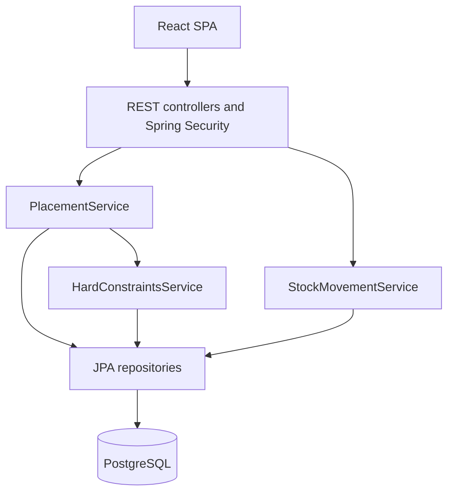

# Backend architecture — placement workflow

Java 25 / Spring Boot / Spring Security / Spring Data JPA / PostgreSQL 17 / Flyway. Controllers expose DTOs; services coordinate business operations; repositories manage persistence. Existing migrations are unchanged.

`PlacementService.confirm` is transactional. Validate IDs, lock batch first and location second using pessimistic write locks, reject a non-awaiting batch or warehouse mismatch, compare the location version, then recheck hard constraints. Update occupied volume and weight, set batch location/status/time, flush managed updates, insert and flush a putaway movement, and return a receipt. The location uses optimistic versioning in addition to the locks. The operator ID is derived from the authenticated account. The movement has a null source for initial putaway. Exceptions are mapped to HTTP errors by ApiExceptionHandler.

`StockMovementService.history` is read-only transactional; validates filters and warehouse existence, delegates to a repository specification, maps DTOs and sorts by performedAt and ID descending. The API uses zero-based pagination.

Transaction boundaries and locks are implemented; atomic rollback and concurrent capacity protection have not yet been established by real PostgreSQL integration tests. See [traceability](../requirements/placement-traceability.md).
