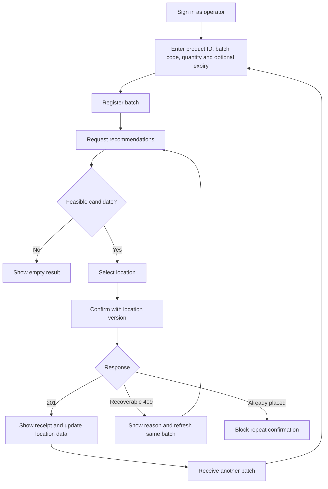

# User flows — placement and history

## Operator: receive and place

If recommendation retrieval fails after registration, retry for the existing batch. A refreshed list requires explicit selection. The success receipt shows movement ID, batch ID, destination, status, total occupancy and time. Receive another batch resets the form and selection. No automatic placement retry is performed.

## Operator, planner, manager: movement history

Open Movement history from navigation; warehouse 1 is the initial filter. Enter optional product/location IDs and dates, select page size and apply. Review results, move between pages or reset filters. Empty results and load failures are shown separately. Business manager and admin are denied; unauthenticated users must sign in.

The current UI supports initial putaway, not a general relocation or override-reason workflow.
