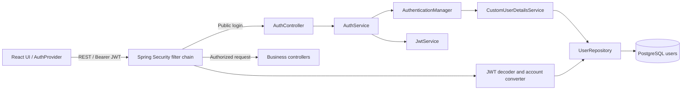

# Security Architecture

## Scope

This document describes the implemented authentication and authorization foundation for the Intelligent Warehouse Slotting Optimization System (API v0.1.0). It supports BA US8.1 and US8.2 and contributes to NFR4. Account administration (US8.3) is not implemented. See [RBAC](rbac.md) for the current permission matrix and [API documentation](../api/README.md) for integration instructions.

## Components and trust boundaries

The browser is not a trusted authorization boundary. Spring Security enforces permissions before business controllers execute. The database is the authoritative source of account status and role. The frontend route guard is a usability control, not a substitute for backend authorization.

| Component | Responsibility |
|---|---|
| `SecurityConfig` | Stateless filter chain, BCrypt encoder, current-account JWT converter and endpoint authorization |
| `JwtConfig` | HS256 key, encoder, decoder and issuer/timestamp validation |
| `JwtService` | Token generation and configured lifetime |
| `CustomUserDetailsService` | Case-insensitive login lookup and account status |
| `AuthService` / `AuthController` | Login and current-user API |
| `UserRepository` | Account lookup |
| `AuthContext.tsx` / `apiClient.ts` | In-memory session, Bearer header and logout handling |
| `permissions.ts` | Frontend route permissions |

## Authentication flow

1. The client sends `POST /api/auth/login` with login and password. This endpoint is public.
2. Request validation rejects blank fields and excessive lengths. AuthService also rejects passwords exceeding 72 UTF-8 bytes (BCrypt limit).
3. AuthenticationManager checks credentials using the stored BCrypt hash. Unknown users, incorrect passwords and inactive accounts are rejected with HTTP 401.
4. AuthService retrieves the active account and issues a signed JWT. The response contains `accessToken`, `tokenType`, `expiresIn` and `user` (ID, login, full name and role). Password hashes are not returned.
5. Subsequent protected requests carry `Authorization: Bearer <accessToken>`.
6. Spring Security validates the signature and issuer/timestamps, then resolves the numeric subject against the database. Missing or inactive accounts are rejected. Authorities are derived from the current database role, not the role claim.
7. The filter chain checks the requested HTTP method and path. Unspecified endpoints are denied. `GET /api/auth/me` returns the current active user's profile.

## JWT configuration

| Setting | Implemented value |
|---|---|
| Algorithm | HS256 (HMAC SHA-256) |
| `JWT_SECRET` | Required Base64-encoded secret, at least 32 decoded bytes |
| `JWT_EXPIRATION_SECONDS` | Positive integer; default 1800 seconds |
| Issuer (`iss`) | `warehouse-slotting` |
| Subject (`sub`) | User ID as a string |
| Other claims | `iat`, `exp`, `login`, `role` (uppercase) |
| Session policy | `STATELESS` |

Tokens are signed, not encrypted. Do not put confidential data in claims. Keep the signing key outside source control and use a separate non-production key for tests. Spring Security's default timestamp validator permits clock skew; the browser timer is not the authoritative expiry check.

## Browser session lifecycle

The frontend stores the access token in module memory and the user in AuthContext. It does not persist credentials or tokens in localStorage or sessionStorage. Login starts a timer based on `expiresIn`. Logout clears the token, user state, timer and React Query cache and requests cancellation of active queries. Reloading the page requires login again. A 401 for the current authenticated request triggers logout; a 403 reports insufficient permissions without ending the session. Login failures do not trigger authenticated-session handling.

Logout is client-side only: an already issued token can remain valid until expiry if copied elsewhere. Deactivating an account blocks subsequent authenticated requests; changing its database role changes backend permissions on subsequent requests. Frontend role information is a login-time snapshot and can remain stale until reauthentication.

## HTTP security behavior

| Condition | Response |
|---|---|
| Invalid login body or excessive password byte length | 400 |
| Invalid credentials, missing/invalid token on protected API, inactive or missing account | 401 |
| Authenticated account lacks required role | 403 |
| Valid authorized request | Business endpoint response |

Security error bodies are not guaranteed to follow a common JSON schema. Form login and HTTP Basic are disabled. CSRF protection is disabled for the current stateless Bearer-header API; reassess this if cookie-based authentication is introduced. Swagger UI and API documentation are public in the current configuration. Internal ERROR dispatches are permitted for error rendering.

## Verification and limitations

Local verification on 24 November 2026: 156 backend tests passed, 13 Vitest tests passed and 18 Playwright executions passed (desktop and mobile). The backend suite includes JWT cryptographic tests and MockMvc authorization tests. The latter mock the decoder and account repository; Playwright uses mocked API responses. Manual API checks covered 45 role/endpoint combinations. JaCoCo reported 84% instruction, 73% branch and approximately 82% line coverage overall. Coverage is not a security audit; real PostgreSQL automated integration testing remains unconfirmed.

## Deployment and future work

- Use HTTPS outside local development; TLS termination is not configured by this authentication module.
- Disable temporary Spring Security DEBUG logging before deployment; never log passwords, signing keys or Bearer tokens.
- Restrict access to Swagger in non-local environments as appropriate.
- Account management, refresh tokens, server-side token revocation, login rate limiting, MFA and key rotation workflows are not implemented in the current foundation.
- Endpoint-level RBAC does not establish per-object or per-warehouse authorization. Reassess access boundaries as the application expands.
- Revalidate security when adding new endpoints, especially placement confirmation, imports, experiments and account management.
